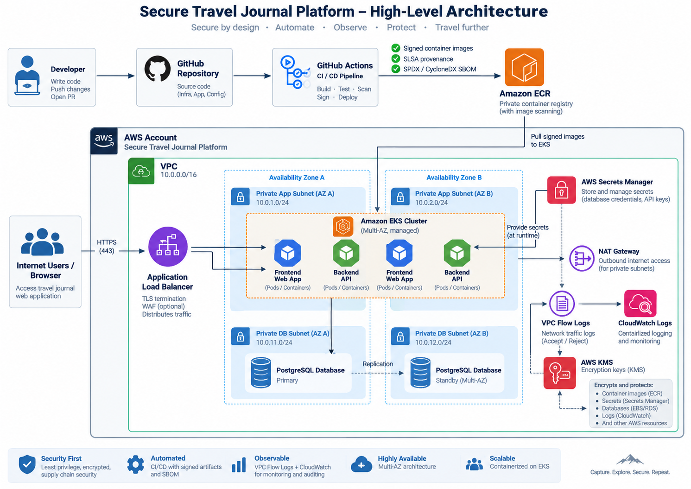
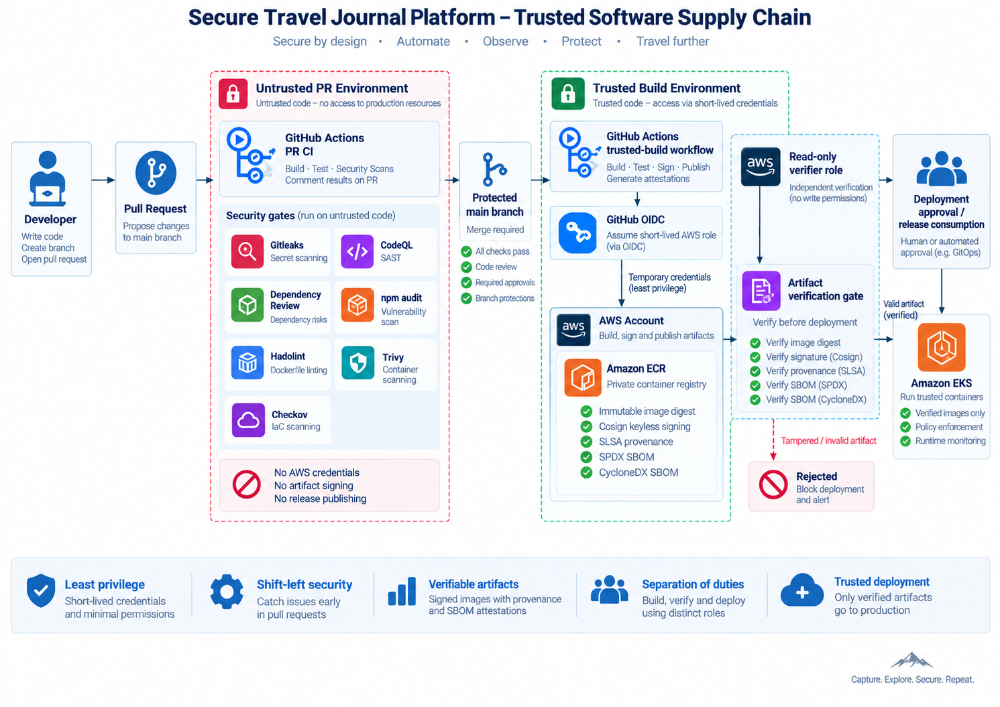
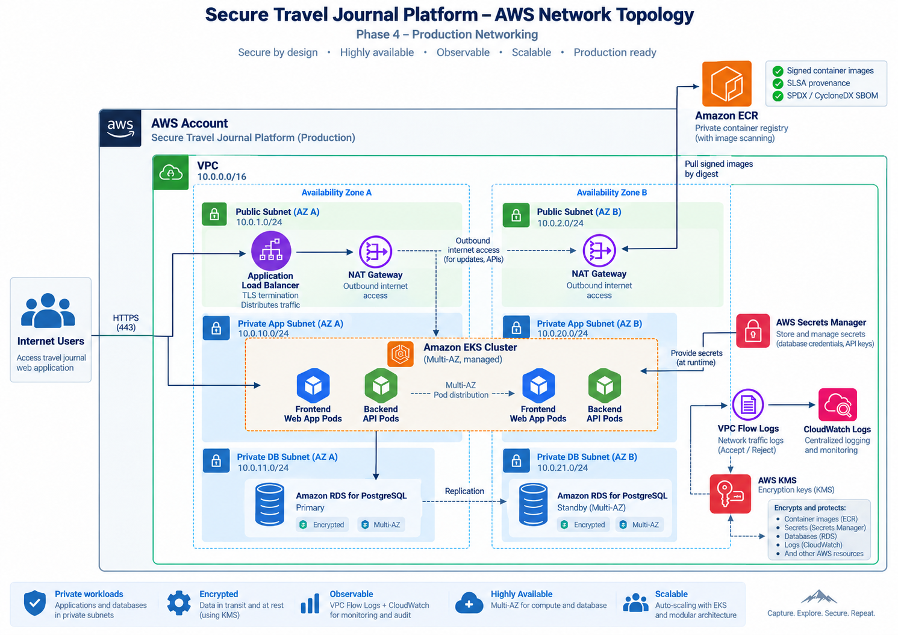

# Secure Travel Journal Platform

A security-focused Cloud Security / DevSecOps portfolio project that traces software from an untrusted pull request through a signed and independently verified container artifact to a hardened AWS runtime platform.

The application is intentionally simple. The main goal is to demonstrate security controls across the software delivery lifecycle and AWS runtime. The AWS platform is deployed with Terraform; the application itself is intentionally not deployed yet.

## What this project demonstrates

- Secure pull request CI/CD controls and separation of untrusted CI from trusted artifact production.
- GitHub OIDC federation to AWS and short-lived STS credentials.
- Least-privilege IAM and separation of build and verification roles.
- Container vulnerability gating and immutable Amazon ECR artifacts.
- Cosign keyless signing, SLSA provenance, and SPDX and CycloneDX SBOMs.
- Independent artifact verification, including negative tests that must fail closed.
- Terraform security, encrypted state management, and Checkov validation.
- Private EKS networking, EKS Auto Mode, workload identity, and Kubernetes network controls.
- Private, encrypted RDS PostgreSQL with managed credentials and scoped database access.
- Evidence-led platform validation and operational lifecycle documentation.

## Current status

| Phase | Capability | Status |
|---|---|---|
| Phase 1 | Application baseline | Complete |
| Phase 2 | Secure pull request CI/CD pipeline | Complete |
| Phase 3 | Trusted software supply chain | Complete |
| Phase 4.1–4.4 | AWS foundation, networking, EKS, and database platform | Complete |
| Phase 4.5 | Workload identity and network boundaries | Complete |
| Phase 4.6 | End-to-end validation, evidence consolidation, negative security tests, and operations/cost documentation | In progress |

**Current focus: Phase 4.6 — validate and close the AWS platform milestone.** The application remains intentionally undeployed.

## Architecture

### Software supply chain





```text
Developer
   |
   v
Pull request — untrusted environment
   |  tests and security scans; no trusted AWS identity
   v
Protected main
   |
   v
Trusted build — GitHub OIDC and short-lived AWS credentials
   |  build, scan, publish, sign, attest, generate SBOMs
   v
Immutable ECR image digest
   |
   v
Independent verification — identity, digest, signature, provenance, SBOM
```

Pull request code is treated as untrusted. Pull request workflows can test and scan code, but they cannot obtain the trusted AWS identity used to publish and sign release artifacts.

See [the trusted software supply chain design](docs/architecture/trusted-software-supply-chain.md).

### AWS runtime platform



The Terraform-managed AWS runtime is organized into separate network trust zones. EKS Auto Mode is configured to run application compute in private subnets. PostgreSQL runs on RDS in isolated database subnets. The application itself is not deployed yet.

Designated workloads are configured to use EKS Pod Identity rather than static AWS credentials or general application permissions inherited from the node role. Backend and database-bootstrap workloads have separate identities and scoped permissions.

When deployed, backend database connectivity requires every one of these controls:

1. Placement on the secured backend NodePool.
2. Authorization by Kubernetes NetworkPolicy.
3. The dedicated Pod security group.
4. `rds-db:connect` IAM authorization.
5. PostgreSQL database authorization.

The backend application cannot retrieve the RDS master credential. The database-bootstrap workload has separate, narrowly scoped access to the specific managed secret it requires.

See:

- [AWS runtime platform architecture](docs/architecture/aws-runtime-platform.md)
- [Platform security control matrix](docs/security/platform-control-matrix.md)
- [Development platform lifecycle and cost notes](docs/operations/dev-platform-lifecycle.md)

## Security controls

| Security objective | Control or enforcement point |
|---|---|
| Keep pull request code untrusted | Workflow permissions and trust separation |
| Authenticate GitHub Actions to AWS | GitHub OIDC and short-lived AWS STS credentials |
| Detect secrets and vulnerable code | Gitleaks, CodeQL, Dependency Review, and `npm audit` |
| Scan container builds | Hadolint and Trivy gates |
| Protect infrastructure changes | Terraform and Checkov |
| Protect build artifacts | ECR digests, Cosign signatures, and SLSA provenance |
| Verify software inventory | SPDX and CycloneDX SBOM attestations |
| Separate publishing from verification | Distinct least-privilege IAM roles |
| Keep EKS nodes off the public internet | Private subnets and VPC routing |
| Limit Kubernetes API exposure | Private endpoint and restricted public access configuration |
| Limit workload AWS permissions | EKS Pod Identity and scoped IAM policies |
| Restrict backend database network access | Backend NodePool, Pod security group, and NetworkPolicy |
| Protect database credentials | RDS-managed Secrets Manager secret and scoped KMS key |
| Restrict database connections | `rds-db:connect` IAM and PostgreSQL authorization |
| Detect network activity | VPC Flow Logs and CloudWatch |
| Reduce accidental deletion risk | EKS and RDS deletion protection |

For the threat-to-control mapping, see the [platform security control matrix](docs/security/platform-control-matrix.md).

## Key security design decisions

### Pull requests receive no trusted AWS identity

Pull request workflows can validate code but cannot publish, sign, or deploy trusted artifacts.

### AWS authentication is federated

GitHub Actions exchanges its OIDC identity for short-lived AWS STS credentials. Long-lived AWS access keys are not stored in the repository.

### Artifacts are identified by digest

Trusted container artifacts use immutable SHA-256 ECR references rather than relying only on mutable tags.

```text
repository@sha256:<digest>
```

### Build and verification roles are separate

The artifact publisher and verifier use separate IAM roles. The verifier has the read permissions it needs and does not receive artifact-publishing permissions.

### Verification fails closed

Successful verification is tested alongside deliberately invalid cases. A mismatched source identity or commit must cause verification to fail.

### Workload identities and database access are separated

Backend and database-bootstrap workloads use separate Pod Identity roles. The backend cannot read the RDS master secret. Database access also depends on network controls and PostgreSQL authorization, not IAM alone.

See [security design decisions](docs/security/security-design-decisions.md) and the [threat model](docs/security/threat-model.md).

## Phase 4.6 validation and closure

Phase 4.6 closes the AWS platform milestone by validating the platform end to end, consolidating architecture and evidence, running deliberate negative security tests, documenting operational and cost considerations, and tagging the infrastructure milestone as `v0.4.0` once the completion criteria pass.

The validation should confirm the deployed AWS and Kubernetes controls against live configuration, run the required policy checks, verify that negative tests are rejected, and record the results under `docs/evidence/`. Do not describe a control as passed until its validation evidence has been captured.

The development platform can incur charges even when application Pods are absent. Review [the lifecycle and cost note](docs/operations/dev-platform-lifecycle.md) before deployment and teardown. For intentional teardown, disable deletion protection through Terraform, review a fresh plan, and then apply that saved plan.

## Trusted artifact evidence

Phase 3 evidence covers the trusted artifact workflow.

| Evidence | What it demonstrates |
|---|---|
| Trusted-build workflow | Controlled artifact production |
| ECR digest | Immutable artifact identity |
| SBOMs | SPDX and CycloneDX inventories |
| SLSA provenance | Build provenance |
| Cosign signatures | Cryptographic artifact identity |
| ECR referrers | Supply-chain evidence associated with an image |
| Verification gate | Successful independent verification |
| Negative verification | Fail-closed policy enforcement |
| IAM evidence | Separation between publisher and verifier |

Phase 4 and Phase 4.5 evidence is maintained under [docs/evidence](docs/evidence/).

## Repository structure

```text
Secure-Travel-Journal-Platform/
├── .github/workflows/       # Pull request and trusted build workflows
├── application/             # Backend and frontend application code
├── infrastructure/          # Terraform infrastructure and bootstrap code
├── platform/                # Kubernetes platform configuration
├── scripts/                  # Validation and security scripts
├── tests/                    # Application and security tests
├── docs/
│   ├── architecture/
│   ├── evidence/
│   ├── operations/
│   ├── runbooks/
│   └── security/
├── docker-compose.yml
├── SECURITY.md
└── README.md
```

## Technology

- **AWS:** Amazon ECR, IAM, STS, KMS, VPC, CloudWatch, EKS, RDS, and Secrets Manager.
- **Infrastructure:** Terraform and Checkov.
- **CI/CD:** GitHub Actions, GitHub OIDC, branch protection, and Dependabot.
- **Application security:** Gitleaks, CodeQL, GitHub Dependency Review, and `npm audit`.
- **Container security:** Docker, Hadolint, and Trivy.
- **Software supply chain:** Cosign, SLSA provenance, SPDX, CycloneDX, and immutable OCI artifacts.
- **Application:** React, Node.js, and PostgreSQL.

## Running locally

Clone the repository and start the local application:

```bash
git clone https://github.com/dissacloud/Secure-Travel-Journal-Platform.git
cd Secure-Travel-Journal-Platform
docker compose up --build
```

The local application provides a realistic artifact for exercising the project's security controls. It is separate from the not-yet-deployed application workload in the AWS runtime.

## Documentation

- [Trusted software supply chain](docs/architecture/trusted-software-supply-chain.md)
- [AWS runtime platform architecture](docs/architecture/aws-runtime-platform.md)
- [Platform security control matrix](docs/security/platform-control-matrix.md)
- [Security design decisions](docs/security/security-design-decisions.md)
- [Threat model](docs/security/threat-model.md)
- [Development platform lifecycle and cost note](docs/operations/dev-platform-lifecycle.md)
- [Evidence](docs/evidence/)
- [Runbooks](docs/runbooks/)

## Security

Do not disclose security issues through public GitHub issues. See [SECURITY.md](SECURITY.md) for the repository security policy and reporting process.

## Project direction

The end-to-end goal is to establish and validate trust from source code through build and artifact production to the AWS runtime platform:

```text
Secure pull request
        ↓
Trusted build
        ↓
Signed and attested artifact
        ↓
Independent verification
        ↓
Amazon ECR
        ↓
Secure AWS runtime platform
        ↓
Amazon EKS workload
        ↓
Amazon RDS PostgreSQL
```

The objective is not simply to deploy an application to AWS. It is to demonstrate how a Cloud Security / DevSecOps engineer establishes and validates trust from source code through build, artifact production, and cloud runtime infrastructure.