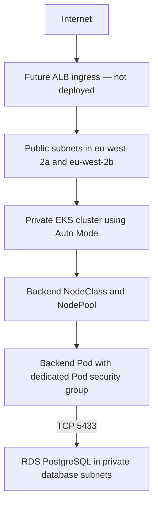
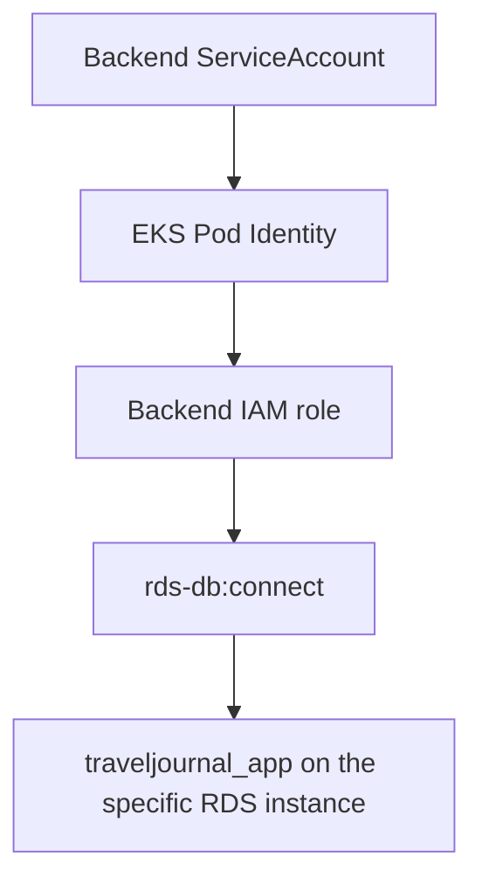
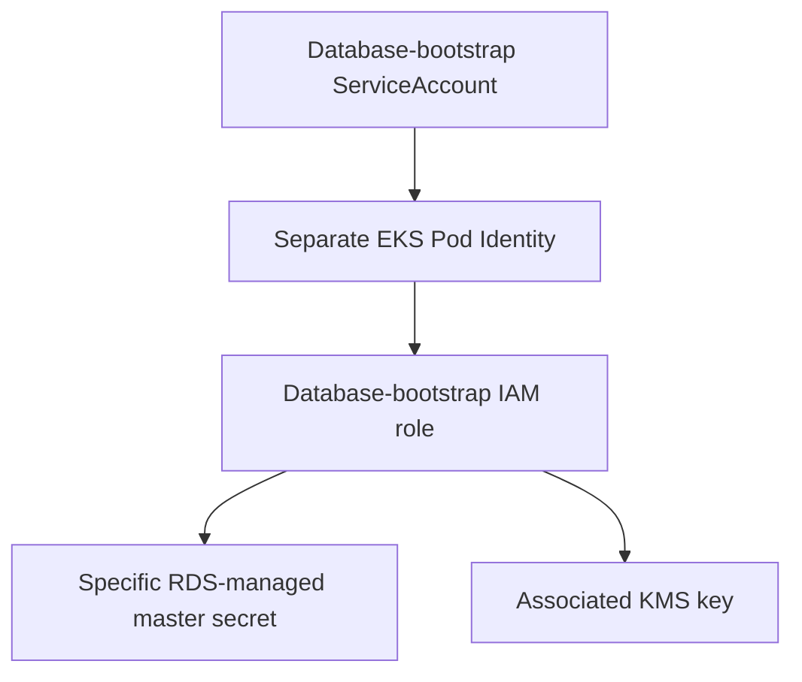

# AWS Runtime Platform Architecture

## Purpose

This document describes the AWS platform and workload security boundaries
implemented for the Secure Travel Journal development environment in
`eu-west-2`.

## Deployment status

The Phase 4 platform and Phase 4.5 workload security controls are configured.

The application itself is intentionally **not deployed**. The ALB and
application traffic path below describe the planned runtime architecture.
They are not evidence that an ALB or backend application is currently
running.

## Network architecture

EKS workloads use private subnets. The backend has a dedicated NodeClass and
NodePool, and its Pods use a separate security group. The RDS security group
allows the required PostgreSQL traffic from the application security group
on TCP port 5433.

The `travel-journal` namespace uses Restricted Pod Security Admission and
default-deny network policies. Backend egress is limited to the destinations
required by the workload.

## AWS identity

The trusted build uses GitHub OIDC to obtain temporary AWS credentials.
This build identity is separate from the identities used by Kubernetes
workloads.

### Backend runtime identity

The backend role is scoped to the `traveljournal_app` database user on the
specific RDS instance. It does not have permission to retrieve the RDS
master secret.

### Database bootstrap identity

The database-bootstrap role is separate from the normal backend role. Its
secret and KMS permissions are scoped to the resources required for database
bootstrap.

## Trusted build and runtime boundary

GitHub OIDC is used by the trusted build workflow. It is not the identity
used by application Pods. Application workloads use EKS Pod Identity.

The application deployment and ALB exposure will be documented in the phase
that introduces those resources.